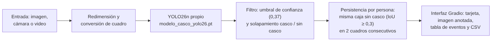

# Detector de uso de casco de seguridad en obra

**Proyecto Integrador · Desarrollo de Soluciones Inteligentes (02DSI243061) · UBO · 2026 S2** Equipo: AMIR · Paralelo: D01 Integrantes: Antonia Moya, Isidora Ramos

---

## 1\. Problema, usuarios y alcance

- **Problema:** en una obra, verificar que cada trabajador lleve casco depende de que un supervisor lo vea en el momento. Con muchas personas, varios frentes de trabajo y turnos largos, esa revisión es lenta, se cansa y se escapa: quien trabaja sin casco puede pasar horas sin que nadie lo note, y el casco solo protege si se lleva puesto.  
- **Usuario:** prevencionista de riesgos o supervisor de obra.  
- **Objetivo:** apoyar la inspección avisando cuando una imagen, una cámara o un video muestra a alguien **sin casco**.  
- **Alcance:** solo casco / sin casco. No reconoce otros EPP (chaleco, guantes, calzado), no identifica personas y **no reemplaza** la inspección humana.  
- **Contexto:** el casco de seguridad protege la cabeza de caídas y de golpes de objetos, pero solo sirve si la persona lo lleva puesto, y en una obra grande nadie puede mirar a todos todo el tiempo. Lo que muestran los estudios:  
  - **El casco reduce las lesiones en la cabeza.** Un estudio con 1.298 personas atendidas en urgencias de Corea por caídas en el trabajo encontró lesión dentro del cráneo en el **4,6 % de quienes llevaban casco** (27 de 584\) y en el **8,7 % de quienes no** (62 de 714): cerca de la mitad del riesgo. El efecto fue claro en caídas de menos de 4 metros; en caídas más altas no se pudo confirmar, y tampoco se vio diferencia significativa en la mortalidad[^1].  
  - **La construcción es donde más se lesiona la cabeza.** La guía de CPWR (2024) indica que la construcción es la industria con más traumatismos cerebrales laborales en EE. UU. Entre 2003 y 2010 murieron 2.210 trabajadores del sector por esta causa, el 25 % de todas sus muertes[^2].  
  - **Es un riesgo grande y frecuente.** En EE. UU., entre 2017 y 2021 murieron 25.684 trabajadores de la construcción y 1.079 (4 %) fallecieron por lesiones en la cabeza; más de 6 millones de trabajadores estaban en cargos que exigen protección para la cabeza[^3].  
  - **Lo que significa para este proyecto:** como el casco funciona cuando se usa, detectar a tiempo a alguien que no lo lleva es una forma concreta de apoyar la supervisión.

## 2\. Datos y trazabilidad

| Campo | Detalle |
| :---- | :---- |
| Dataset | *Hard Hats* v6 (`resized640_noAugmentation-RF-DETR`) |
| Origen | [https\://universe.roboflow.com/roboflow-universe-projects/hard-hats-fhbh5/dataset/6](https://universe.roboflow.com/roboflow-universe-projects/hard-hats-fhbh5/dataset/6) |
| Workspace | `roboflow-universe-projects` |
| Licencia | CC BY 4.0 (se reconoce la autoría en este README y en el informe) |
| Exportación | 21-01-2026, formato YOLO |
| Tamaño | 19.745 imágenes: 13.782 train · 3.962 valid · 2.001 test |
| Clases | `Hardhat` (casco) y `NO-Hardhat` (sin casco) |
| Preprocesamiento del autor | Orientación automática (EXIF) y redimensión a 640×640 con *stretch*; sin aumentación |
| Huella del archivo usado | SHA-256 del zip: `d105ed599f42c48b9198dbc93b02a80847c14e2555b4769398778dc92fe7c6f4` |

**Preparación propia:** no se modificaron las imágenes ni las etiquetas del dataset. Se descomprimió el zip y se creó un `data.yaml` con rutas absolutas para Colab. El modelo se entrena con *train*, el umbral se elige en *valid* y la evaluación final se hace en *test*. Durante el entrenamiento, Ultralytics aplica aumentos de datos en memoria (como mosaico, giros y variación de color) que no se guardan en disco. Para comparar modelos se toma una muestra aleatoria reproducible (semilla 42\) de *valid* (150 imágenes; se elige el umbral) y de *test* (200 imágenes; evaluación final, una sola vez), con IoU ≥ 0,5. Las etiquetas YOLO se convierten a cajas en píxeles.

**Limitaciones de los datos:** las imágenes están estiradas a 640×640, mientras que un video real tiene otra proporción, así que el rendimiento en cámara real puede ser distinto. El dataset es de terceros y puede no representar las obras del contexto del equipo. Solo contiene dos clases. Varias imágenes no son de obra (reunión en oficina, grupos con mascarillas, fotos de stock), hay personas con el rostro identificable y faltan algunas etiquetas (personas sin casco sin caja). Además, una revisión del equipo con hash perceptual del mismo dataset encontró que cerca del 9 % de *test* es idéntico a *train* y cerca del 20 % es casi idéntico, por lo que las métricas probablemente son optimistas.

## 3\. Técnica / modelo y decisión

- **Modelo usado:** **YOLO26n** (Ultralytics, tamaño *nano*), ajustado por el equipo con el dataset Hard Hats v6 a partir de los pesos preentrenados `yolo26n.pt` (*transfer learning*). Configuración: 30 épocas, imágenes de 640 px, batch 16, paciencia 10, semilla 42, GPU T4 de Colab. El resultado es `modelo_casco_yolo26.pt` (5,5 MB). Se ejecuta **sin API key y sin cuenta de Roboflow**, y para analizar no usa ningún servicio externo de inferencia. Código: `Entrenamiento_YOLO26.ipynb`.  
- **Por qué este modelo:** (1) detecta exactamente las dos clases del problema; (2) no necesita API key ni créditos para inferir, lo que hace la demo reproducible por cualquier persona con el archivo `.pt`; (3) es rápido (14 ms por imagen en la GPU T4 de Colab) y lo bastante liviano como para correr en la CPU de un computador o de un Space gratuito; (4) el dataset es público y con licencia abierta (CC BY 4.0).  
- **Alternativas consideradas (medidas en las mismas 200 imágenes de *test*, con el umbral de cada modelo elegido en *valid*):**

| Modelo | Umbral | P sin casco | R sin casco | F1 sin casco | Alerta por imagen (de 40 con alguien sin casco) | Dependencias |
| :---- | :---- | :---- | :---- | :---- | :---- | :---- |
| YOLO26n propio (usado) | 0,40 | 0,936 | 0,914 | 0,925 | recall 0,975 (1 perdida) · precisión 0,975 (1 falsa alarma) | ninguna externa |
| Modelo alojado en Roboflow (`hard-hats-fhbh5/6`) | 0,30 | 0,906 | 0,977 | 0,940 | recall 1,00 (0 perdidas) · 2 falsas alarmas | internet, API key y créditos |

El modelo alojado rinde algo mejor en recall de "sin casco" (0,977 frente a 0,914), pero se desconoce con qué imágenes fue entrenado, así que su resultado puede estar inflado; además exige API key, internet y créditos, y es más lento por ser una consulta remota. Con una muestra de solo 128 cajas de "sin casco" la diferencia puede caber en el margen de error. Se eligió el modelo propio por reproducibilidad y autonomía, aceptando este costo.

- **Decisión de umbral:** se elige en *valid* (máximo F1 de "sin casco") y se evalúa en *test* una sola vez. **Umbral elegido: 0,40** (F1 de "sin casco" en la muestra de *valid*: 0,769). Es la configuración inicial de la demo y se puede ajustar con un control deslizante; con cámara real puede convenir bajarlo (ver sección 7).  
- **Filtro de solapamiento:** como medida de precaución, la demo conserva solo la caja de mayor confianza cuando dos cajas de clases distintas se solapan (IoU ≥ 0,5). Con el modelo propio no se observó que marque la misma cabeza con las dos clases.  
- **Lógica de alerta:** un cuadro con "sin casco" es *POSIBLE*; se confirma como *ALERTA* si aparece en al menos 2 de los últimos 3 cuadros analizados.

## 4\. Arquitectura e integración



La app (interfaz y modelo) corre en un mismo lugar, que es un Space de Hugging Face (principal) o Colab (respaldo); no usa servicios externos de inferencia.

Interfaces y datos: la imagen entra como archivo, cuadro de cámara o video; el modelo devuelve cajas con clase y confianza; la app entrega estado, imagen anotada, tabla de eventos (hora o minuto del video) y CSV. En Colab, cada alerta confirmada guarda además una captura; en el Space público no se guardan capturas.

| Componente | Archivo | Función |
| :---- | :---- | :---- |
| Entrenamiento y evaluación | `Entrenamiento_YOLO26.ipynb` | Entrena YOLO26n, evalúa en *test* (mAP, precisión, recall), elige el umbral en *valid* y guarda el `.pt`. |
| Modelo | `modelo_casco_yolo26.pt` | Pesos usados por la demo. |
| Demo publicada (principal) | Space de Hugging Face (carpeta `hf_space/`: `app.py`, `modelo_casco_yolo26.pt`, `requirements.txt`, `packages.txt`, `README.md`) | La app disponible con un enlace fijo, sin instalar nada: [https\://huggingface.co/spaces/AntoM07a/Detector-Casco](https://huggingface.co/spaces/AntoM07a/Detector-Casco) |
| Demo en Colab (respaldo) | `Demo_Gradio_Casco_sinKey_local.ipynb` | App web (Gradio) con cámara en vivo y video grabado, sin API key. |
| Validación del hito 30-10 | `Bitacora_Validacion_Clase11.ipynb` | Validación con el modelo alojado en Roboflow (requiere API key): contrato, 12 casos de prueba, v1 frente a v2, robustez y bitácora. |
| Demostrador mínimo | `T03_Equipo_Integracion.ipynb` | Integración del Taller 03 con el modelo alojado (requiere API key). |

## 5\. Requisitos y cómo ejecutar

**Requisitos:** para usar la demo publicada, solo un navegador (con cámara para el modo en vivo). Para el respaldo en Colab, una cuenta de Google. **No necesita API key.** Entrenar sí requiere una GPU (la T4 gratuita de Colab sirve).

**Dependencias:** `ultralytics`, `gradio` (≥ 5), `opencv-python`, `pandas`, `pillow` y `numpy` (`hf_space/requirements.txt`). Colab ya trae todas menos `ultralytics`; **no reinstalar `pillow`** (rompe el entorno). Si aparece `ImportError`: *Entorno de ejecución → Reiniciar sesión* y ejecutar desde la celda de configuración. El video anotado usa `ffmpeg` si está instalado.

**Pasos: demo publicada (Hugging Face Spaces)**

1. Abrir [https\://huggingface.co/spaces/AntoM07a/Detector-Casco](https://huggingface.co/spaces/AntoM07a/Detector-Casco) en el navegador. Si lleva varios días sin uso, el Space está dormido y tarda cerca de un minuto en despertar.  
2. En la pestaña "Cámara en vivo", permitir el acceso a la cámara; o en "Video grabado", subir un video y presionar "Analizar video".  
3. Para volver a publicarla: crear un Space de tipo Gradio en Hugging Face (hardware ZeroGPU, gratuito), subir los archivos de `hf_space/` y dejarlo en visibilidad pública. La app corre en CPU; la función `@spaces.GPU` que contiene solo cumple el requisito de la plataforma y no se usa.

**Pasos: demo en Colab (respaldo)**

1. Subir `Demo_Gradio_Casco_sinKey_local.ipynb` a Colab y dejar `modelo_casco_yolo26.pt` en Drive; ajustar `MODELO_PT` en la celda de configuración (si no lo encuentra, pide subir el archivo).  
2. Ejecutar todas las celdas.  
3. Abrir el enlace `…gradio.live` **en una pestaña nueva** (la cámara no funciona embebida en Colab) y permitir la cámara. El enlace es temporal y se cierra si se cierra la sesión.

**Pasos: reproducir el entrenamiento**

1. Subir el zip del dataset a Drive y poner su ruta en `DATASET_ZIP` de `Entrenamiento_YOLO26.ipynb`.  
2. Activar GPU (T4) y ejecutar todas las celdas. Los resultados quedan en Drive.

**Opcional (modelo alojado):** los notebooks `Bitacora_Validacion_Clase11.ipynb` y `T03_Equipo_Integracion.ipynb` requieren `inference-sdk`, una cuenta gratuita de Roboflow y su API key guardada en *Secretos* de Colab como `ROBOFLOW_API_KEY`. Nunca escribir la clave en una celda.

## 6\. Pruebas y resultados

Cifras de la ejecución del equipo de `Entrenamiento_YOLO26.ipynb` (GPU T4).

- **Test completo (2.001 imágenes, 5.518 cajas, mAP de Ultralytics):**

| Clase | Precisión | Recall | mAP50 | mAP50-95 |
| :---- | :---- | :---- | :---- | :---- |
| Todas | 0,921 | 0,899 | 0,947 | 0,602 |
| Hardhat | 0,920 | 0,901 | 0,948 | 0,554 |
| NO-Hardhat | 0,922 | 0,896 | 0,946 | 0,651 |

- **Muestra de *test* (200 imágenes, 128 cajas "sin casco" en 40 imágenes), umbral 0,40, IoU ≥ 0,5:**

| Clase | Precisión | Recall | F1 |
| :---- | :---- | :---- | :---- |
| Casco | 0,918 | 0,886 | 0,901 |
| Sin casco | 0,936 | 0,914 | 0,925 |

A nivel de imagen (¿hay alguien sin casco?): recall 0,975 y precisión 0,975, con 1 imagen perdida y 1 falsa alarma.

- **Umbral:** 0,40, elegido en una muestra de 150 imágenes de *valid* (F1 de "sin casco" 0,769). No se cambió después de ver *test*.  
- **Velocidad:** 14 ms por imagen en la GPU T4 (0,014 s en la muestra de 200). En el Space público la app corre en CPU compartida y no se midió su velocidad.  
- **Comparación con el modelo alojado en Roboflow:** ver tabla de la sección 3\.  
- **Pruebas de integración y robustez con el modelo alojado (hito 30-10, `Bitacora_Validacion_Clase11.ipynb`):** 12 casos de prueba definidos antes de ejecutar; la app v1 cumple 1 de 12 y la v2 cumple 11 de 12 (CP-11, comparación exacta con la consulta directa, falló en 1 de 5 imágenes sin causa identificada). Casos límite probados: archivo que no es imagen, imagen dañada, campo ausente, umbral 0 y 1,5, imagen de 16 px (rechazada) e imagen gris sin personas. Robustez en 30 imágenes con "sin casco": con baja resolución (50 %) se mantuvieron las 30 alertas; con poca luz (brillo 40 %) se perdió 1\. **Estas pruebas se hicieron con el modelo alojado, no con el modelo propio, y no se repitieron con este.**  
- **Prueba con datos propios (video o cámara de obra):** observaciones cualitativas del equipo, no una métrica.  
  - *Cámara en vivo, persona con un gorro (sin casco):* con umbral 0,9 no se detectó nada; con 0,5 se detectó como **POSIBLE** sin casco; con 0,3 se detectó **sin casco**. A mayor umbral, el modelo deja de reportar a la persona, lo que coincide con que la confianza del modelo en este caso es intermedia; con el umbral inicial (0,40) no se registró prueba en cámara.  
  - *Video de capacitación en seguridad en la construcción (5 min 52 s, de terceros:* procesado con `modelo_casco_yolo26.pt` y las reglas de la app (umbral 0,40, un cuadro cada 2 s, filtro de solape y persistencia de 2 de 3), en CPU y fuera del Space. De 177 cuadros analizados, 77 tuvieron cascos detectados (168 cajas en total), 15 tuvieron "sin casco" (42 cajas) y 9 quedaron confirmados como ALERTA. En una revisión visual de esos 15 cuadros hubo aciertos (personas sin casco en una reunión y en un comedor) y falsos positivos (un auto y personas con casco). No se contaron los cascos no detectados ni se anotó el video cuadro a cuadro, así que no permite calcular recall ni precisión.  
  - *Conclusión:* en cámara real conviene un umbral de 0,3 a 0,5 (no 0,9), lo que respalda dejar el control deslizante ajustable. Con el gorro la persona fue detectada solo en umbrales bajos, así que hay riesgo de no alertar si el umbral se sube demasiado.  
- **Evidencia:** notebooks ejecutados con salidas visibles, `Bitacora_Validacion.xlsx`, `Bitacora_Validacion.pdf`, `Evidencia_Validacion_Casco.zip`, `eventos_camara.csv` y `eventos_video.csv` (generados por la app), y la captura de la app publicada funcionando.

## 7\. Limitaciones conocidas y riesgos

- **No es tiempo real continuo:** la demo analiza un cuadro cada 2 s (ajustable); pueden perderse eventos más cortos. La velocidad depende de si hay GPU; en el Space público corre en CPU compartida y puede ir más lenta, y si lleva días sin uso tarda en despertar.  
- **Falsos negativos:** una persona sin casco no alertada es el error más grave. En la muestra de *test* se perdió 1 de 40 imágenes con alguien sin casco, y el recall por caja de "sin casco" fue 0,914. Pueden ocurrir con poca luz, distancia, oclusión, ángulos raros o cascos poco comunes.  
- **Falsas alarmas:** gorras, capuchas u otros objetos pueden confundirse. La persistencia temporal las reduce, pero no las elimina.  
- **Métricas optimistas:** una parte de *valid* y *test* es casi idéntica a *train* (ver sección 2\) y el umbral se eligió con solo 150 imágenes. El rendimiento en una cámara real distinta (otra luz, otra proporción de imagen) puede ser peor; por eso la demo permite bajar el umbral.  
- **Muestreo:** la comparación con el modelo alojado usa una muestra de 200 imágenes (128 cajas de "sin casco"); la diferencia entre ambos puede caber en el margen de error.  
- **Alcance de las pruebas:** los casos de prueba y la robustez se ejecutaron con el modelo alojado, no con el propio (ver sección 6). La robustez cubrió solo dos cambios (poca luz y baja resolución).  
- **Privacidad:** en Colab, el modelo y las imágenes se procesan en la sesión y no se envían a otros servicios; las capturas de alertas se guardan en la carpeta `eventos`: borrarlas al terminar. En el Space público, las imágenes de quien lo usa se envían al servidor de Hugging Face donde corre la app; la app no guarda capturas ni imágenes. El Space es público: cualquier persona con el enlace puede usarlo, por lo que no debe compartirse fuera del curso, y debe haber autorización de las personas filmadas, sin buscar identificarlas. El enlace público de Gradio de Colab es temporal; usar `USUARIO_CLAVE` si se comparte.  
- **Seguridad:** la demo no usa claves. No incluir claves, capturas con personas identificables ni datos personales en notebooks o repositorios. Como el Space es público, su código y el modelo son visibles para cualquiera.  
- **Uso:** el resultado es orientativo y no reemplaza la inspección de seguridad.

## 8\. Licencias y créditos

- Dataset: *Hard Hats* v6, Roboflow Universe Projects, CC BY 4.0 — [https\://universe.roboflow.com/roboflow-universe-projects/hard-hats-fhbh5/dataset/6](https://universe.roboflow.com/roboflow-universe-projects/hard-hats-fhbh5/dataset/6)  
- Modelo: YOLO26n de Ultralytics (pesos preentrenados `yolo26n.pt`), ajustado por el equipo. Ultralytics se distribuye bajo licencia AGPL-3.0 (y licencia empresarial); el uso en este trabajo es académico. El Space público publica el código y el modelo, lo que es coherente con esa licencia.  
- Estructura de pruebas y validación: Clase 11 de Desarrollo de Soluciones Inteligentes (UBO), adaptada al detector de cascos.  
- Plataforma de publicación: Hugging Face Spaces.  
- Librerías (licencias según los metadatos de cada paquete en PyPI, consultados el 06-11-2026): `ultralytics` (AGPL-3.0), `gradio` (Apache-2.0), `opencv-python` (Apache-2.0), `pandas` (BSD-3-Clause), `numpy` (BSD-3-Clause, con componentes bajo otras licencias permisivas), `pillow` (MIT-CMU, equivalente a HPND), `torch` (BSD-3-Clause, con componentes bajo otras licencias permisivas) y `spaces` (Apache-2.0, solo en el Space). Solo para el modelo alojado: `inference-sdk`, `reportlab`, `openpyxl` (licencias no verificadas).

## 9\. Declaración ampliada de uso de IA generativa

| Aspecto | Detalle |
| :---- | :---- |
| Herramienta | Claude (Anthropic) |
| Finalidad | Apoyo en código y estructura de los notebooks y de la app, diagrama, redacción de este README, borrador de textos de análisis de la bitácora, propuesta de métricas y del protocolo de comparación de modelos, y preparación de los archivos para publicar la app en Hugging Face Spaces. |
| Componentes afectados | `Entrenamiento_YOLO26.ipynb`, `Demo_Gradio_Casco_sinKey_local.ipynb`, `app.py` (versión del Space), `Bitacora_Validacion_Clase11.ipynb`, `T03_Equipo_Integracion.ipynb` y este README. |
| Verificación realizada | El equipo ejecutó los notebooks en Colab con el dataset y el modelo reales; las cifras de este README provienen de esas ejecuciones. |
| Cambios humanos | El equipo decidió usar un modelo propio en lugar del modelo alojado en Roboflow, para no depender de API key ni de internet. Se entrenó el modelo en Colab y se ejecutaron todos los notebooks con el dataset real; además se configuraron las rutas de Drive (AMIR/DATASET\_ZIP) y el umbral, y se publicó la app en un Space de Hugging Face con la cuenta del equipo. Escribimos los textos de análisis de la bitácora. Editamos el README, elegimos qué contexto y qué fuentes dejar en el README (solo estudios sobre cascos de seguridad) y revisamos que las cifras coincidieran con las ejecuciones. |

&nbsp;

## 10\. Estructura del repositorio

```
├── README.md
├── arquitectura.png                      # diagrama de la sección 4
├── modelo_casco_yolo26.pt                # pesos del modelo YOLO26n usado
├── Entrenamiento_YOLO26.ipynb            # entrenamiento, evaluación y umbral
├── Demo_Gradio_Casco_sinKey_local.ipynb  # demo en Colab, respaldo (sin API key)
├── hf_space/                             # archivos de la demo publicada en Hugging Face Spaces
│   ├── app.py
│   ├── modelo_casco_yolo26.pt
│   ├── requirements.txt
│   ├── packages.txt
│   └── README.md
├── Bitacora_Validacion_Clase11.ipynb     # validación del hito 30-10 (modelo alojado)
├── Bitacora_Validacion.xlsx              # bitácora en Excel
├── Bitacora_Validacion.pdf               # evidencia de la validación
├── Evidencia_Validacion_Casco.zip        # CSV, métricas, gráficos y protocolo con la huella del dataset
├── T03_Equipo_Integracion.ipynb          # demostrador mínimo del Taller 03
└── T03_Equipo_Resumen.pdf                # resumen del Taller 03
```

&nbsp;

[^1]: Kim, S. C., Ro, Y. S., Shin, S. D. y Kim, J. Y. (2016). *Preventive Effects of Safety Helmets on Traumatic Brain Injury after Work-Related Falls*. Int. J. Environ. Res. Public Health, 13(11), 1063\. [https\://pmc.ncbi.nlm.nih.gov/articles/PMC5129273](https://pmc.ncbi.nlm.nih.gov/articles/PMC5129273) (estudio observacional; el uso del casco lo informaron los propios pacientes).

[^2]: CPWR (2024). *Selecting Head Protection for Construction Work*. [https\://stacks.cdc.gov/view/cdc/213050](https://stacks.cdc.gov/view/cdc/213050)

[^3]: Weaver, A., Kemp, J., Ojiambo, W. y Simmons, A. (2024). *From Hard Hats to Helmets: The History and Future of Head Protection*. Professional Safety, 69(8), 34-43 (ASSP; datos de BLS).